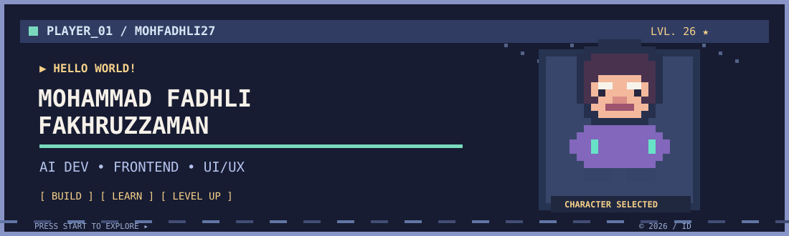

<div align="center">



<br/>

<a href="https://www.linkedin.com/in/mohammadfadhli27"></a>
<a href="https://portofolio-fadhli.netlify.app"></a>
<a href="mailto:mohfadli095@gmail.com"></a>

<br/><br/>


</div>

### 🎮 `PLAYER INFO / whoami`

```typescript
const fadhli = {
  name: "Mohammad Fadhli Fakhruzzaman",
  location: "Indonesia 🇮🇩",
  education: "Multimedia Engineering Technology @ PENS",
  focus: ["AI Agents", "Frontend Development", "UI/UX Design"],
  currentlyExploring: ["Agentic RAG", "Local LLMs", "Intelligent Apps"],
};
```

### 🧰 `INVENTORY / tech_stack`

<div align="center">


<br/>


<br/>

`LLMs` · `RAG` · `AI Agents` · `Ollama` · `vLLM`

</div>

### 🗺️ `QUEST LOG / featured-repositories`

| Project | Description | Stack |
|:--|:--|:--|
| **DARSI** | AI-powered hospital information and customer service assistant using agentic retrieval. | `LLM` `RAG` `AI Agents` |
| **[SAPADARSI](https://github.com/mohfadhli27/sapadarsi)** | AI consultation platform with doctor, midwife and pharmacist agents, and staff monitoring. | `Next.js` `TypeScript` `PostgreSQL` |

### ⭐ `PLAYER STATS / github`

<div align="center">

<picture>
<source media="(prefers-color-scheme: dark)" srcset="https://github-readme-stats.vercel.app/api?username=mohfadhli27&show_icons=true&hide_border=true&bg_color=171C32&title_color=79D9BD&text_color=E6E9F4&icon_color=8267BC"/>
<source media="(prefers-color-scheme: light)" srcset="https://github-readme-stats.vercel.app/api?username=mohfadhli27&show_icons=true&hide_border=true&bg_color=FFFFFF&title_color=0891B2&text_color=334155&icon_color=7C3AED"/>

</picture>
<picture>
<source media="(prefers-color-scheme: dark)" srcset="https://github-readme-stats.vercel.app/api/top-langs/?username=mohfadhli27&layout=compact&hide_border=true&bg_color=171C32&title_color=79D9BD&text_color=E6E9F4"/>
<source media="(prefers-color-scheme: light)" srcset="https://github-readme-stats.vercel.app/api/top-langs/?username=mohfadhli27&layout=compact&hide_border=true&bg_color=FFFFFF&title_color=0891B2&text_color=334155"/>

</picture>

</div>

### 👾 `ARCADE MODE / contributions`

<div align="center">

**SNAKE.EXE**

<picture>
<source media="(prefers-color-scheme: dark)" srcset="https://raw.githubusercontent.com/mohfadhli27/mohfadhli27/snake-output/snake-dark.svg"/>
<source media="(prefers-color-scheme: light)" srcset="https://raw.githubusercontent.com/mohfadhli27/mohfadhli27/snake-output/snake.svg"/>

</picture>

**PACMAN.EXE**

<picture>
<source media="(prefers-color-scheme: dark)" srcset="https://raw.githubusercontent.com/mohfadhli27/mohfadhli27/pacman-output/pacman-contribution-graph-dark.svg"/>
<source media="(prefers-color-scheme: light)" srcset="https://raw.githubusercontent.com/mohfadhli27/mohfadhli27/pacman-output/pacman-contribution-graph.svg"/>

</picture>

<sub>`[ GAME SAVED ✓ ]` · Thanks for visiting. See you at the next level!</sub>

</div>
