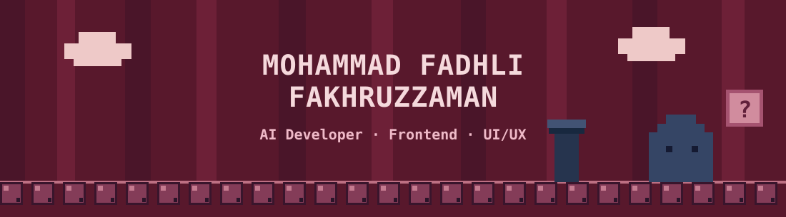

 

 

### ✦ 01 — A little about me

I'm a **Multimedia Engineering Technology graduate from PENS, Indonesia**, working at the intersection of **AI engineering, web development, and visual design**. I enjoy turning complex ideas into intuitive, useful products.

| `01 / INTELLIGENCE` | `02 / ENGINEERING` | `03 / EXPERIENCE` |
|:--|:--|:--|
| **AI Agents & RAG** | **Web & APIs** | **UI/UX & Visuals** |
| LLMs, Generative AI, retrieval pipelines | Frontend, backend, integrations | Prototyping, interaction, design systems |

### ✦ 02 — My toolkit

**LANGUAGES & FRAMEWORKS**

**DATABASE · DEVOPS · DESIGN**

LLMs · RAG · AI Agents · Ollama · vLLM · API Development

### ✦ 03 — Selected work

FEATURED PROJECTS / AI & DIGITAL HEALTHCARE

<table>
<tr>
<td width="50%" valign="top">
  
<b>01 / AI ENGINEERING</b>

  <h3>✦ DARSI</h3>
  <b>Digital Assistant for RSI</b>
  
An AI-powered assistant supporting hospital customer service and information access through retrieval-augmented generation and intelligent agents.

  
<code>GENERATIVE AI</code> <code>AGENTIC RAG</code> <code>HEALTHCARE</code>

  HOSPITAL INFORMATION ASSISTANT
</td>
<td width="50%" valign="top">
  
<b>02 / AI PRODUCT DEVELOPMENT</b>

  <h3>✦ SAPADARSI</h3>
  <b>AI-Powered Patient Consultation Platform</b>
  
A patient-facing consultation platform with AI doctor, midwife and pharmacist agents, plus staff monitoring and consultation approval workflows.

  
<code>NEXT.JS</code> <code>TYPESCRIPT</code> <code>AI AGENTS</code>

  <a href="https://github.com/mohfadhli27/sapadarsi"><b>↗ Explore repository</b></a>
</td>
</tr>
</table>

EXPLORE MORE DESIGN & DEVELOPMENT WORK ON <a href="https://portofolio-fadhli.netlify.app">MY PORTFOLIO ↗</a>

### ✦ 04 — Developer activity

<picture>
<source media="(prefers-color-scheme: dark)" srcset="https://github-readme-stats.vercel.app/api?username=mohfadhli27&show_icons=true&hide_border=true&bg_color=1A1225&title_color=E8A8BC&text_color=F2DDE5&icon_color=C57B90"/>
<source media="(prefers-color-scheme: light)" srcset="https://github-readme-stats.vercel.app/api?username=mohfadhli27&show_icons=true&hide_border=true&bg_color=FFF5F7&title_color=8D2C49&text_color=56304B&icon_color=C57B90"/>

</picture>
<picture>
<source media="(prefers-color-scheme: dark)" srcset="https://github-readme-stats.vercel.app/api/top-langs/?username=mohfadhli27&layout=compact&hide_border=true&bg_color=1A1225&title_color=E8A8BC&text_color=F2DDE5"/>
<source media="(prefers-color-scheme: light)" srcset="https://github-readme-stats.vercel.app/api/top-langs/?username=mohfadhli27&layout=compact&hide_border=true&bg_color=FFF5F7&title_color=8D2C49&text_color=56304B"/>

</picture>

### ✦ 05 — Contribution playground

THE SNAKE TRAIL

<picture>
<source media="(prefers-color-scheme: dark)" srcset="https://raw.githubusercontent.com/mohfadhli27/mohfadhli27/snake-output/snake-dark.svg"/>
<source media="(prefers-color-scheme: light)" srcset="https://raw.githubusercontent.com/mohfadhli27/mohfadhli27/snake-output/snake.svg"/>

</picture>

PAC-MAN ARCADE

<picture>
<source media="(prefers-color-scheme: dark)" srcset="https://raw.githubusercontent.com/mohfadhli27/mohfadhli27/pacman-output/pacman-contribution-graph-dark.svg"/>
<source media="(prefers-color-scheme: light)" srcset="https://raw.githubusercontent.com/mohfadhli27/mohfadhli27/pacman-output/pacman-contribution-graph.svg"/>

</picture>

✦ DESIGN WITH INTENTION. BUILD WITH CURIOSITY. ✦

