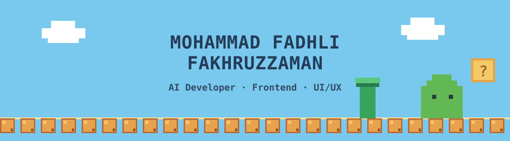

 

 

### ✦ 01 — A little about me

I'm a **Multimedia Engineering Technology graduate from PENS, Indonesia**, working at the intersection of **AI engineering, web development, and visual design**. I enjoy turning complex ideas into intuitive, useful products.

| `01 / INTELLIGENCE` | `02 / ENGINEERING` | `03 / EXPERIENCE` |
|:--|:--|:--|
| **AI Agents & RAG** | **Web & APIs** | **UI/UX & Visuals** |
| LLMs, Generative AI, retrieval pipelines | Frontend, backend, integrations | Prototyping, interaction, design systems |

### ✦ 02 — My toolkit

**LANGUAGES & FRAMEWORKS**

**DATABASE · DEVOPS · DESIGN**

LLMs · RAG · AI Agents · Ollama · vLLM · API Development

### ✦ 03 — Selected projects

<table>
<tr>
<td width="50%" valign="top">
  <h3>🤖 DARSI</h3>
  <b>Digital Assistant for RSI</b>
  
AI-powered hospital assistant for customer service and information access, built around LLMs, retrieval-augmented generation, and intelligent agents.

  <code>AI AGENTS</code> <code>RAG</code> <code>PYTHON</code>
</td>
<td width="50%" valign="top">
  <h3>📦 Indospring Inventory</h3>
  <b>Inventory Management System</b>
  
Web-based inventory tracking, incoming/outgoing transactions, and stock reporting.

  <a href="https://indospring-inventory.vercel.app/"><b>↗ Live website</b></a> &nbsp;·&nbsp; <a href="https://github.com/mohfadhli27/indospring-inventory"><b>⌘ Source code</b></a>
</td>
</tr>
</table>

MORE PROJECTS & CREATIVE WORK AT <a href="https://portofolio-fadhli.netlify.app">MY PORTFOLIO ↗</a>

### ✦ 04 — Developer activity

<picture>
<source media="(prefers-color-scheme: dark)" srcset="https://github-readme-stats.vercel.app/api?username=mohfadhli27&show_icons=true&hide_border=true&bg_color=0D1117&title_color=D4A373&text_color=E7E1D9&icon_color=C47757"/>
<source media="(prefers-color-scheme: light)" srcset="https://github-readme-stats.vercel.app/api?username=mohfadhli27&show_icons=true&hide_border=true&bg_color=FFFFFF&title_color=A9684E&text_color=51483E&icon_color=C47757"/>

</picture>
<picture>
<source media="(prefers-color-scheme: dark)" srcset="https://github-readme-stats.vercel.app/api/top-langs/?username=mohfadhli27&layout=compact&hide_border=true&bg_color=0D1117&title_color=D4A373&text_color=E7E1D9"/>
<source media="(prefers-color-scheme: light)" srcset="https://github-readme-stats.vercel.app/api/top-langs/?username=mohfadhli27&layout=compact&hide_border=true&bg_color=FFFFFF&title_color=A9684E&text_color=51483E"/>

</picture>

### ✦ 05 — Contribution playground

THE SNAKE TRAIL

<picture>
<source media="(prefers-color-scheme: dark)" srcset="https://raw.githubusercontent.com/mohfadhli27/mohfadhli27/snake-output/snake-dark.svg"/>
<source media="(prefers-color-scheme: light)" srcset="https://raw.githubusercontent.com/mohfadhli27/mohfadhli27/snake-output/snake.svg"/>

</picture>

PAC-MAN ARCADE

<picture>
<source media="(prefers-color-scheme: dark)" srcset="https://raw.githubusercontent.com/mohfadhli27/mohfadhli27/pacman-output/pacman-contribution-graph-dark.svg"/>
<source media="(prefers-color-scheme: light)" srcset="https://raw.githubusercontent.com/mohfadhli27/mohfadhli27/pacman-output/pacman-contribution-graph.svg"/>

</picture>

✦ DESIGN WITH INTENTION. BUILD WITH CURIOSITY. ✦

